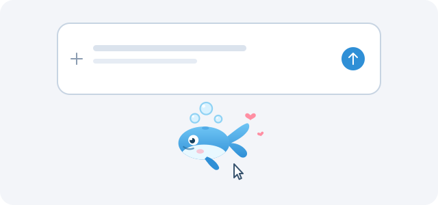

# Little Whale

A little blue whale that floats over the DeepSeek Harness Web UI. It keeps an eye on what you spend, tells you how much of today's budget is left, and changes its outfit when you click it.



## What it does

- **Lives on the page** — it floats above the app; drag it anywhere and the position is remembered.
- **Talks without opening a panel** — click the whale and it says how much of today's budget is left (or how far over you are), with a soft sound and an optional bright system voice.
- **Eight looks** — colours, bow, sailor hat, flower, heart glasses, bow tie, crown and headphones; every click switches to the next look with a sparkle.
- **Spend ledger** — the bubble's **Open ledger** button shows this chat's estimated spend, today's total, a budget bar and input/cache/output token counts.
- **Rename it** — call the whale whatever you like.
- **Resize it** — 70% to 160%.
- **Naps** — after a configurable idle time (5 minutes by default) it closes its eyes, breathes slowly and floats little Zzz; click it to wake it. Set `0` to keep it awake.
- **Cute audio** — short synthesized sounds and an optional read-aloud voice; both can be switched off.

## Install

With a DSH that supports `dsh plugin add`:

```sh
dsh plugin add github:renqianyu2/dsh-plugin-little-whale
```

Or, once the plugin is listed in the market: **Plugins → Discover → Little Whale → Install**.

The plugin is a standard DSH bundle (`dsh.bundle`), with a Web client half that uses the conversation composer and the shell overlay slot. It is developed against DSH `0.2.2`.

## Use

1. Click the whale: it changes its look, says the remaining budget, and shows a speech bubble.
2. Click **Open ledger** in the bubble to see the spend details.
3. Drag the whale anywhere; the speech bubble and ledger follow it.
4. Open **Settings** at the bottom of the ledger to change the name, look, size, nap time, sound/voice, prices and daily budget, or to reset the day or the position.

## About the spend estimate

The ledger estimates spend from the session's token usage (`uncached input`, `cache read/write`, `output`) multiplied by the prices you set. It is **an estimate, not a provider invoice**. Default prices are a reference for DeepSeek-style pricing; set them to your actual provider's rates for a meaningful number.

"Today" is what this browser has observed since the ledger was last reset. Pressing **Reset today** restarts it at zero.

## Privacy

Everything stays in this browser's `localStorage`: name, look, position, size, sleep time, prices, budget and the ledger. The plugin makes no network requests and sends no data anywhere. It is decoration and bookkeeping only; it does not send messages or change your conversation.

## Files

- `client.js` — the whole Web UI (whale artwork, ledger, speech, sounds, drag/resize/sleep).
- `index.js` / `cordis.patch.yml` — the DSH bundle manifest and loader row.
- `locale/` — plugin-manager metadata (English and Chinese).
- `icon.svg`, `assets/icon-180.png` — artwork.
- `docs/` — the detail image and its Markdown.

No build step, no dependencies. Plain ES modules and React from the DSH browser module table.

## Development

```sh
# add the checkout to a DSH profile
dsh plugin add /absolute/path/to/dsh-plugin-little-whale
```

Reload the page after changing `client.js`. The client half is loaded by DSH's `/plugins` route.

## License

MIT © renqianyu2
